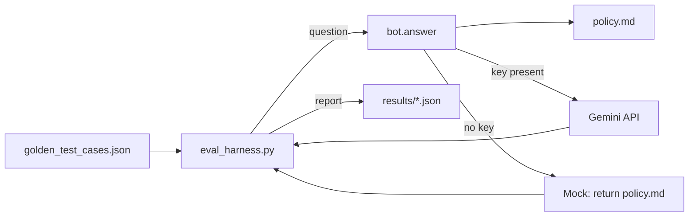

# Automated Eval Harness

## Project overview

A small, self-contained evaluation harness for an LLM customer-support bot. It
runs the bot against a fixed set of 10 golden questions, checks whether each
answer contains the required policy phrases, prints a pass/fail report, and
saves every run as JSON.

The point is regression testing: change `bot.py`, `policy.md`, or the prompt,
re-run the harness, and immediately see whether answer quality got better or
worse.

The bot can run against the real Gemini API or an offline mock. The mock simply
returns the whole policy document, so it trivially satisfies the keyword checks
and only proves the harness plumbing works. Use a real API key for meaningful
scores.

## Architecture



`eval_harness.py` loads the cases, calls `bot.answer()` for each question,
compares the answer against the required phrases, and records the result.
`bot.py` loads `policy.md`, sends the policy plus question to Gemini when
`GEMINI_API_KEY` is available, and otherwise falls back to the mock.

## Setup

### 1. Install dependencies

Uses the current `google-genai` package. Do not install the deprecated
`google-generativeai` package.

**Windows (PowerShell):**

```powershell
cd "C:\Users\Hp\Desktop\AI portfolio projects\automated-eval-harness"
python -m venv venv
venv\Scripts\Activate.ps1
pip install -r requirements.txt
```

**macOS / Linux:**

```bash
cd path/to/automated-eval-harness
python3 -m venv venv
source venv/bin/activate
pip install -r requirements.txt
```

### 2. Configure the Gemini key (optional)

The key is only needed for real Gemini answers. Without it, the harness runs
against the offline mock. Create a key in Google AI Studio, then: Create a key in Google AI Studio, then:

1. Copy the template:

   **Windows:**

   ```powershell
   Copy-Item .env.example .env
   ```

   **macOS / Linux:**

   ```bash
   cp .env.example .env
   ```

2. Edit `.env` and set your key:

   ```
   GEMINI_API_KEY=your_actual_api_key_here
   ```

`bot.py` loads `.env` automatically. The file is excluded from git, so the key
never gets committed. A `GEMINI_API_KEY` already set in your shell takes
precedence over `.env`.

The default model is `gemini-3.1-flash-lite`. To pin a different one, add this
to `.env`:

```
GEMINI_MODEL=gemini-3.1-flash-lite
```

**Alternative: set the key in your shell.** Instead of `.env`, you can export it
for one session:

```powershell
$env:GEMINI_API_KEY="your_actual_api_key_here"
```

```bash
export GEMINI_API_KEY="your_actual_api_key_here"
```

### 3. Run the eval

```bash
python eval_harness.py
```

Run it again after changing `bot.py`, `policy.md`, or the prompt, and compare
the score to the previous run.

## What you'll see

The harness prints a summary and one line per case:

```
============================================================
EVAL RESULTS — 10/10 passed (100% accuracy)
============================================================

[PASS] #1: Can I return a used item?
[PASS] #2: Do you offer free shipping on returns?
...

Full report saved to: results/eval_2026-10-18T14-11-17.826616+00-00.json
```

Every run is saved in `results/` with its timestamp, score, answers, and any
missing phrases. Because the mock returns the entire policy, the keyword checks
pass trivially; use a real Gemini key when you want to measure actual answer
quality.

## Files

- `policy.md` — the store's return/shipping/warranty policy; the bot's
  knowledge base.
- `bot.py` — **the system under test.** Builds the prompt, calls Gemini or the
  mock, and returns the answer.
- `golden_test_cases.json` — **the answer key.** 10 questions and the phrases
  each correct answer must contain.
- `eval_harness.py` — **the harness.** Runs the cases, grades the answers,
  prints a report, and saves the full results.
- `results/` — timestamped JSON reports from previous runs.
- `requirements.txt` — Python dependencies.
- `.env.example` — API key template. Copy it to `.env` and fill in your key.
- `.env` — your local key; excluded from git.
- `MAAZ-NOTES.md` — working notes and background on the project.

## Troubleshooting

- **`PSSecurityException` when running `Activate.ps1`** — run PowerShell as
  admin once and set the execution policy:
  `Set-ExecutionPolicy -Scope CurrentUser RemoteSigned`
- **Gemini authentication error** — confirm `GEMINI_API_KEY` is set in `.env`
  or your shell, and that the key is valid.
- **It still uses the mock** — an empty or missing key means the mock is used.
  Run `python -c "import bot, os; print(bool(os.environ.get('GEMINI_API_KEY')))"`
  inside the project with the venv activated.

## Extending this

1. **Grow the golden set** — add more questions to `golden_test_cases.json`
   using the same `id`, `question`, and `must_include` format.
2. **Add LLM-as-judge scoring** — for cases where keyword matching is too
   coarse, write a rubric and have Gemini score each answer 1–5 on tone and
   completeness, alongside the pass/fail count.
3. **Track runs over time** — read the JSON files in `results/` and plot
   accuracy across runs.
4. **Run it in CI** — fail the build when the score drops below a threshold.
